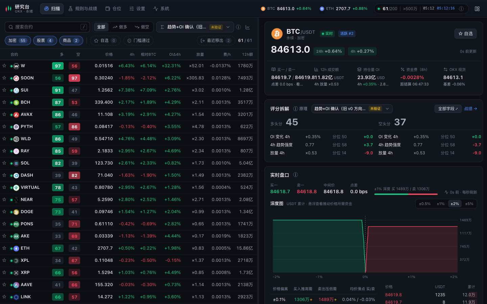
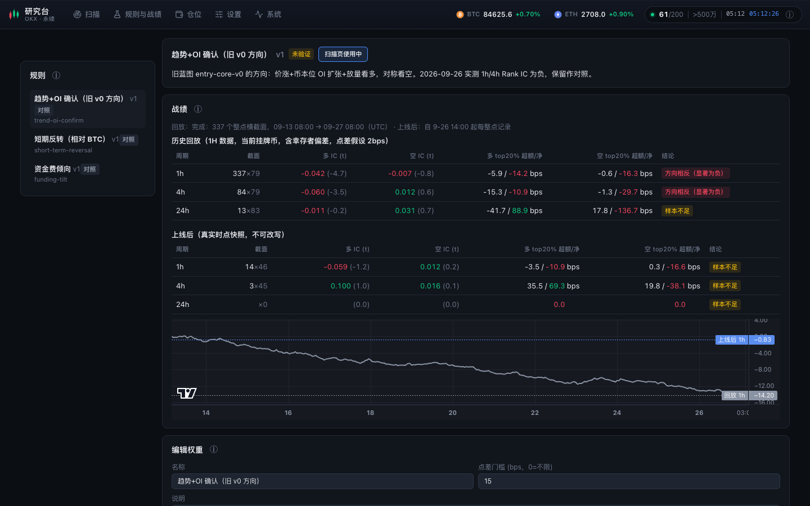
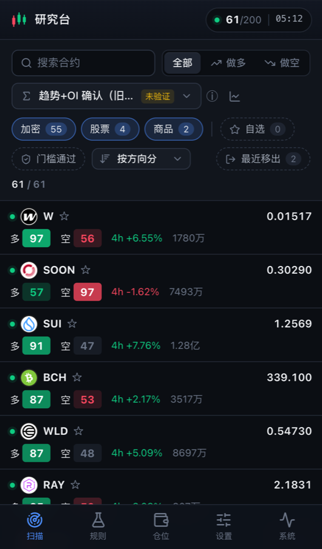

# crypto-trader-go · OKX Helper

个人使用的 **OKX USDT 永续合约研究工具**：实时发现流动性足够的合约，客观呈现每个币的状态（事实面板），用你自己定义的规则打分，并自动用之后的真实行情检验规则是否有效（战绩）。

> 只用 OKX **公开**行情接口：不需要 API Key、不读账户、**不下单**。分数是规则排序，不是胜率或交易建议。

线上：**https://ctg.gugenzzz.top**（ctg-prod，Docker；暂未启用登录，见[待办](docs/roadmap.md)）。



## 功能

| 页面 | 能做什么 |
|---|---|
| 扫描 | 监控池列表（默认 12h 成交额 > 500 万 USDT，最多 200 个，含加密/股票/商品永续）；按多/空分或任意字段排序、过滤；自选；PC 左右分栏、手机独立详情页 |
| 详情 | 行情头部指标卡片，点击可看详情：实时 400 档盘口、USDT 深度图（悬浮显示推动价格 x% 所需资金）、成交额、持仓量、资金费、基差；评分拆解；K 线（1m–4H，可叠加现货）；相对 BTC/ETH 走势；OI 与资金费历史；PC 端面板可拖拽排序 |
| 规则与战绩 | 编辑多/空权重与点差门槛（保存即新版本）；每条规则的 1h/4h/24h Rank IC、t 值、前 20% 超额与扣费净收益；14 天历史回放加上线后不可改写的记录 |
| 设置 | 阈值、上限 N、类别、默认规则，保存后立即生效 |
| 系统 | 阶段、覆盖率、WS 连接、REST 用量、数据库行数、回放与历史回补进度 |

<p>
  
  
</p>

## 工作方式

1. **录制**：启动时拉取合约列表，用 WebSocket 订阅全部候选合约的 1m K 线，REST 补缺口，写入 SQLite（WAL）。
2. **监控池**：每分钟按最近 720 根已收盘 1m K 线的 USDT 成交额重算，超过阈值的取前 N 个。
3. **事实面板**：收益、相对 BTC 强弱、OI 变化、放量、资金费、基差等指标，实时计算和历史回放用同一套公式。
4. **打分**：每个指标在池内取分位并映射到 ±1，按规则权重加权，得到 `50 + 50·Σwx/Σ|w|`；每 10 秒按未收盘分钟预览，整点时生成不可改的快照。
5. **战绩**：用快照之后的真实收益计算 Rank IC、t 值和分位收益，判断规则是否有效。

更详细的内容见 [架构与目录](docs/architecture.md)。

## 技术栈

| 层 | 选型 |
|---|---|
| 后端 | Go 1.25 单二进制；标准库 `net/http`（REST + SSE）；`go:embed` 内嵌前端 |
| 存储 | SQLite WAL（`modernc.org/sqlite`，纯 Go、免 CGO） |
| 数据 | OKX v5 公开 REST / WebSocket（自带限频、自愈重连、可选代理/DoH） |
| 前端 | Vue 3 + TypeScript + Vite；Reka UI；lightweight-charts；lucide 图标 |
| 部署 | distroless 运行时镜像 + 挂载二进制（升级不重建镜像）；nginx 反代 |

## 快速开始

需要 Go 1.25+ 和 Node 22+。

```bash
git clone https://github.com/genguzzz/crypto-trader-go.git && cd crypto-trader-go
(cd web && npm ci)
make build                     # 构建前端并打包进 bin/ctg
./bin/ctg                      # http://127.0.0.1:8686 ，数据在 data/ctg.db
make test                      # go vet + go test -race + vue-tsc
```

前后端分开调试：

```bash
./bin/ctg -web=false           # 只跑 API（:8686）
cd web && npm run dev          # Vite 开发服务器，/api 代理到 :8686
```

首次启动约 30 秒出临时名单，约 4 分钟完成全池回填进入实时；之后后台回放 14 天、回补 7 天 1m K 线。重启约 1 分钟追平。

## 部署

push 到 `main` 后 GitHub Actions 自动测试并部署（`.github/workflows/deploy.yml`，首次需运行 `deploy/setup-ci.sh` 配置密钥）。本机手动部署：

```bash
deploy/deploy.sh               # 构建 → 上传二进制 → 替换 → 重启容器 → 健康检查（失败自动回滚），约 30 秒
deploy/deploy.sh --rollback    # 回到上一版
deploy/deploy.sh --status      # 容器状态与日志
```

数据和设置都存在服务器的 SQLite 里，升级不受影响。详见 [运行与部署](docs/operations.md)。

## 目录

```
cmd/server/        入口与启动参数
internal/okx/      OKX REST/WS 适配（限频、重连、代理）
internal/market/   引擎：录制、监控池、预览、规则回放、盘口、查询
internal/features/ 事实面板公式
internal/rules/    规则定义与打分
internal/track/    战绩统计
internal/store/    SQLite 存储
internal/api/      HTTP 路由、SSE、图标代理、gzip
web/               Vue 前端（构建产物内嵌进二进制）
deploy/            docker-compose 与一键部署脚本
docs/              架构、运维、设计规范、里程碑、蓝图
research/poc/      调研阶段可复跑的实测程序
openspec/          需求与变更记录
```

## 文档

| 文档 | 内容 |
|---|---|
| [架构与目录](docs/architecture.md) | 模块划分、数据流、关键算法、技术选型 |
| [运行与部署](docs/operations.md) | 线上环境、一键部署/回滚、本机开发、参数、排查 |
| [界面设计规范](docs/design-guidelines.md) | 信息层级、设计 token、说明文字交互化等前端规则 |
| [里程碑与待办](docs/roadmap.md) | 已完成 / 待办 / 功能清单 |
| [蓝图修订 2026-09-26](docs/blueprint/revision-2026-09-26.md) | 用实测数据纠正的方案与决策记录 |
| [调研探针](research/poc/README.md) | 公共接口实测程序与结果 |

## 免责声明

本项目仅用于个人研究，不构成任何投资建议。加密资产与衍生品风险极高，使用者自行承担风险。
